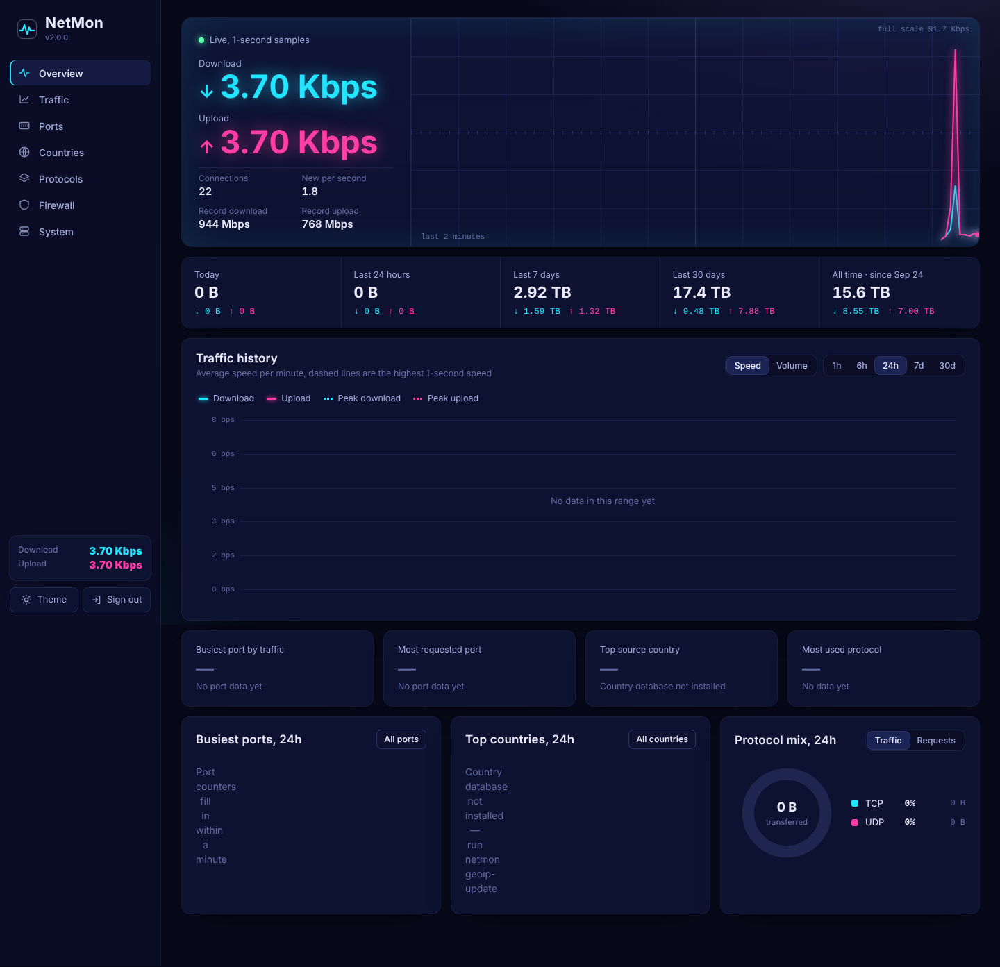
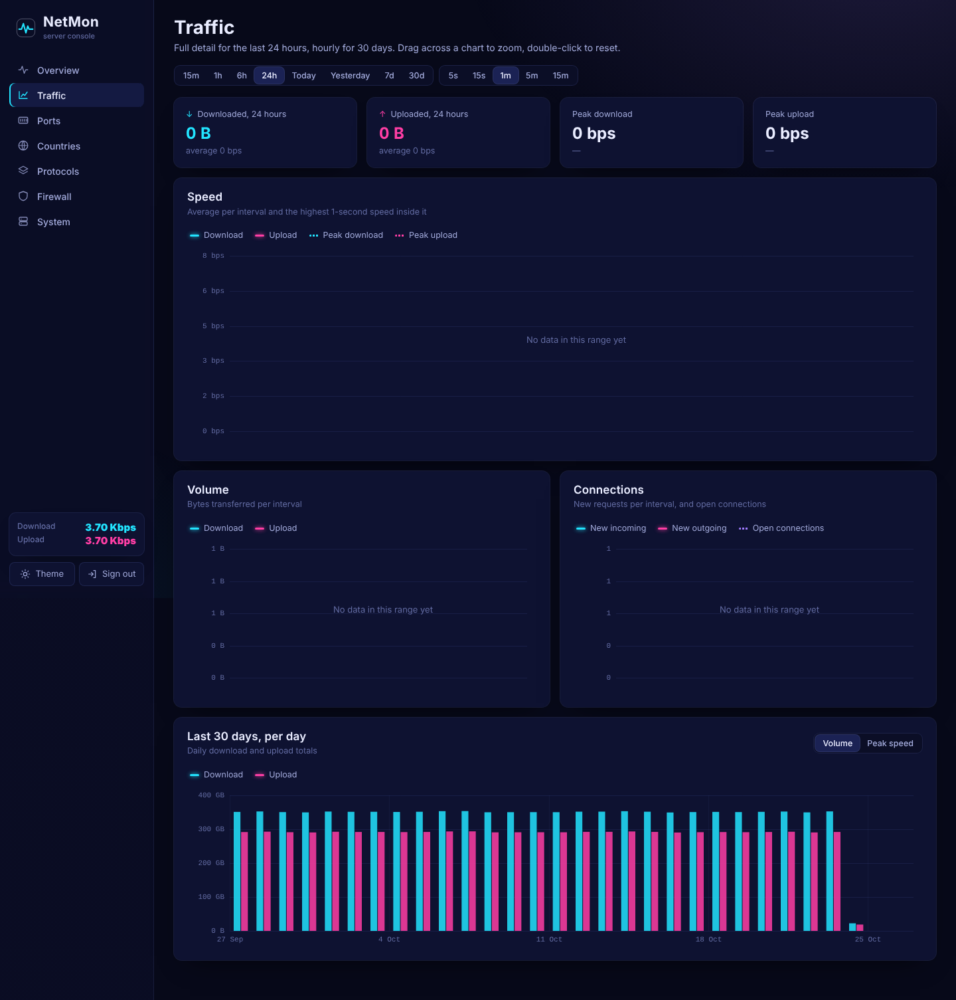
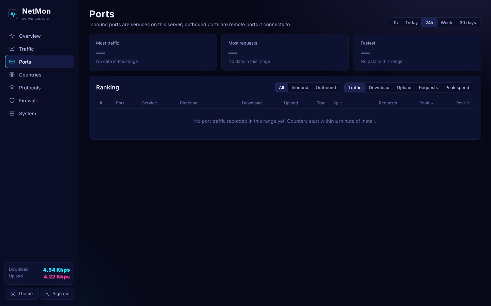
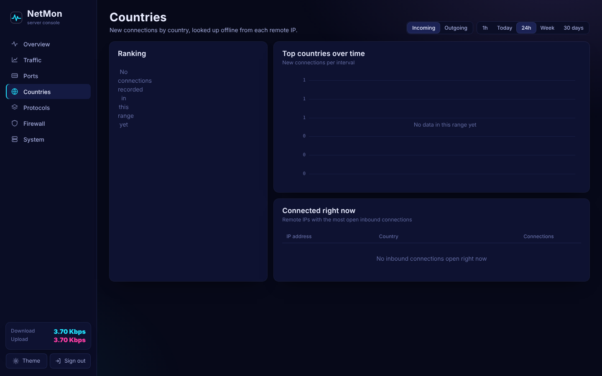
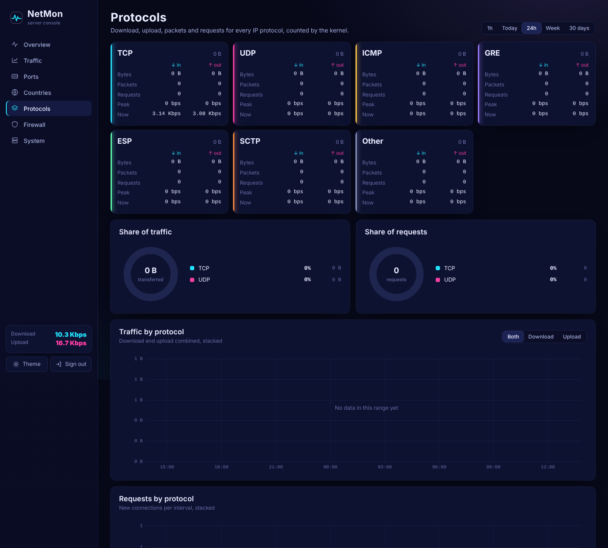
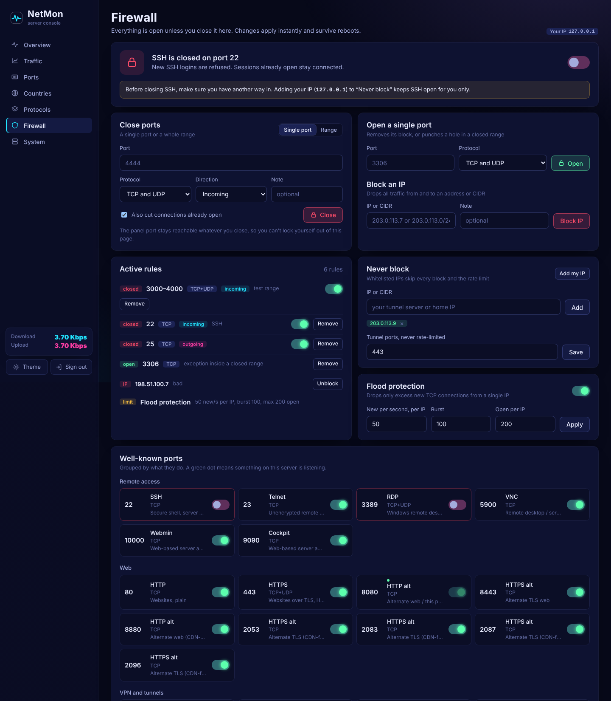
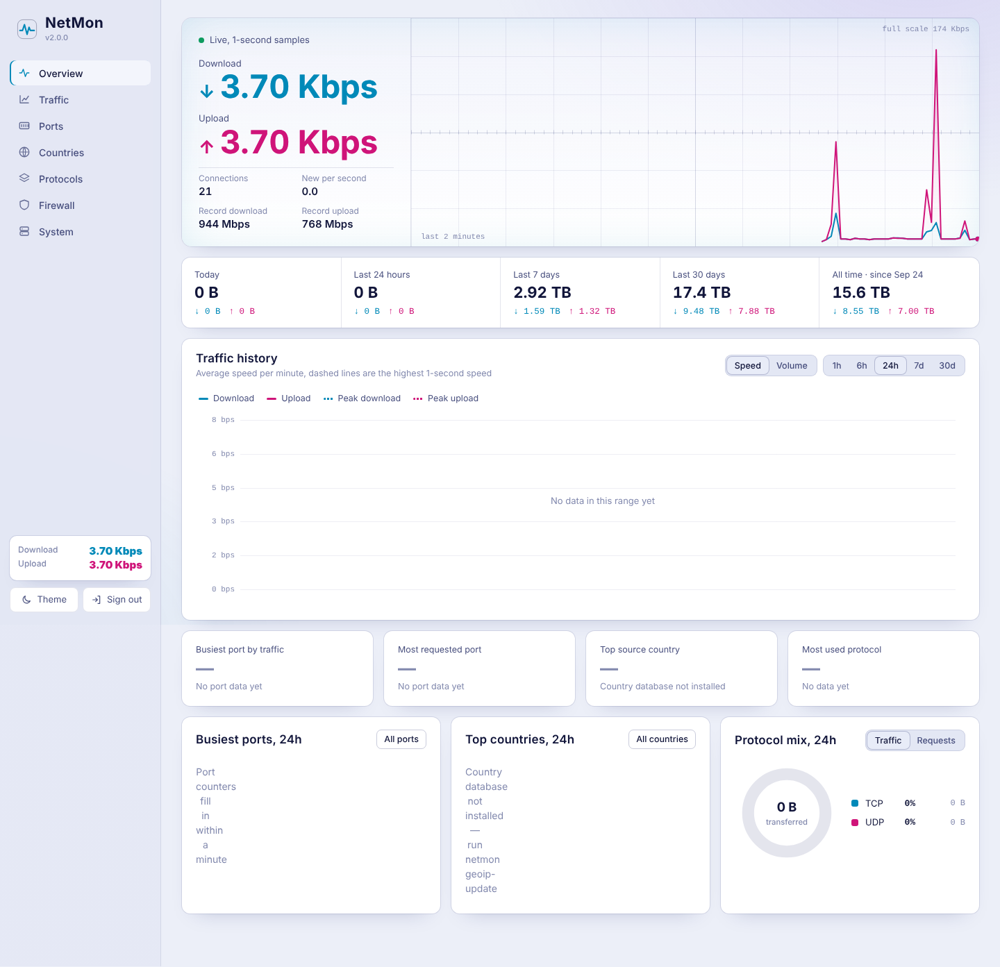
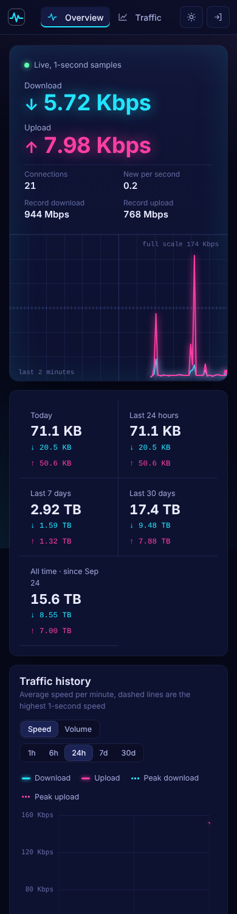

<div align="center">

# NetMon

**Lightweight traffic monitor, firewall and neon web panel for Linux servers.**

Per-port, per-protocol and per-country traffic, exact kernel counters, 30 days of history,
and a firewall you can drive from your browser. Pure Python standard library + SQLite.


[فارسی](README.fa.md) · [Install](#install) · [Screenshots](#screenshots) · [How it measures](#how-it-measures) · [Firewall](#firewall)



</div>

## Features

- **Live speed** sampled every second, with all-time record download and upload speeds and when they happened.
- **History**: 5-second detail for the last 24 hours, hourly for 30 days, daily totals for the month.
- **Every protocol separated**: TCP, UDP, ICMP, GRE, ESP, SCTP and other, each with download, upload, packets, requests and peak speed.
- **Ports**: download and upload per port, requests per port, peak speed per port, split into inbound (services on your server) and outbound (remote ports it talks to). Busiest port, most-requested port and fastest port are highlighted.
- **Countries** with flags: rankings of where connections come from (and go to) for the last hour, today, 24 h, week and 30 days, a trend chart, and a live list of connected IPs with a one-click block.
- **Firewall**: close single ports or ranges, open one port inside a closed range, pause or remove rules, block IPs, SSH switch, optional flood protection.
- **Well-known ports** grouped by purpose (remote access, web, VPN and tunnels, proxy, mail, DNS, file sharing, databases, messaging, containers) with on/off switches and a marker when something is listening.
- **Precise charts**: hover for exact values, click legend items to hide series, drag to zoom, double-click to reset.
- **Day and night themes**, mobile-friendly, served entirely from your server (no CDN at runtime).
- **Light**: one service, about 25 MB RAM, a few MB of disk, no pip packages.

## Screenshots

| | |
|---|---|
|  |  |
|  |  |
|  |  |

<p align="center"></p>

<sub>Screenshots use demo data.</sub>

## Install

On Ubuntu 20.04+ or Debian 11+, as root:

```bash
sudo bash -c "$(curl -fsSL https://raw.githubusercontent.com/USERNAME/netmon/main/get.sh)"
```

Or from a clone:

```bash
git clone https://github.com/USERNAME/netmon.git
cd netmon
sudo bash install.sh
```

The installer:

1. installs `python3`, `iptables`, `conntrack` and `iproute2` (waits for or frees a stuck apt lock),
2. asks for the **admin username and password**,
3. optionally asks for IPs that must never be blocked (your tunnel server, your own IP),
4. opens TCP **8080** for the panel. Nothing else is closed,
5. starts the `netmon` service and downloads fonts and the country database in the background.

Then open `http://YOUR-SERVER-IP:8080`.

Non-interactive install:

```bash
sudo NETMON_USER=admin NETMON_PASS='a-long-password' NETMON_PORT=8080 bash install.sh
```

Running the installer again upgrades in place and keeps your settings, rules and history. Version 1.x is upgraded automatically.

## Commands

| Command | What it does |
|---|---|
| `sudo netmon status` | Show what is being measured and where data lives |
| `sudo netmon passwd` | Change the admin username or password |
| `sudo netmon unblock-all` | Emergency: remove every NetMon block and the rate limit |
| `sudo netmon geoip-update` | Download the country database now, with progress (`--no-ipv6` for a smaller download) |
| `sudo netmon geoip-import v4.csv [v6.csv]` | Build the country database from CSV files you downloaded elsewhere |
| `sudo netmon fw-apply` | Re-apply firewall rules from the config |
| `journalctl -u netmon -f` | Follow the logs |
| `sudo bash uninstall.sh` | Remove NetMon and every rule it added |

## How it measures

| What | Source | Detail kept |
|---|---|---|
| Total download / upload, live speed, 1-second peaks | `/proc/net/dev`, read every second | 5 s for 24 h, hourly for 30 days |
| Per protocol: bytes, packets, requests, peaks | iptables counting rules in the `mangle` table | 1 min for 24 h, hourly for 30 days |
| Per port: download, upload, requests, peaks | per-port counting rules, picked automatically from listening ports, the busiest inbound ports and the busiest outbound destinations | 1 min / hourly |
| Requests | kernel `conntrack` state `NEW` counters (exact) | as above |
| Countries | the conntrack table every 10 s, looked up offline | 1 min / hourly |

- Counting rules have no ACCEPT or DROP target, so they can never change how traffic flows.
- Counting happens in PREROUTING / POSTROUTING on the internet-facing interface, so IPv4, IPv6 and forwarded (NAT / tunnel) traffic are all included.
- The country database is the public-domain [geo-whois-asn-country](https://github.com/sapics/ip-location-db) list, compacted to about 1–2 MB and refreshed monthly by a systemd timer.

## Firewall

NetMon writes only to chains it owns (`NM_*`) and rebuilds them atomically from `/etc/netmon/config.json`. Your own iptables, ufw or nftables rules are never edited, and every rule survives reboots.

- **Open by default.** Nothing is closed unless you close it.
- **Close** a single port or a range, for incoming, outgoing or both, TCP, UDP or both. Rules can be paused and resumed.
- **Open one port** inside a closed range (for example close 10000–20000 but keep 12345).
- **SSH switch.** Closing port 22 refuses new logins only; sessions already open stay connected. Add your IP to *Never block* to keep SSH for yourself.
- **Block IPs or CIDRs**, both directions, straight from the live connection list.
- **Flood protection** (off by default): limits new TCP connections per source IP. Whitelisted IPs and tunnel ports are exempt.
- **You can't lock yourself out of the panel**: its port always stays reachable.
- Inbound rules run in `mangle PREROUTING`, before NAT, so they also cover ports forwarded to tunnels or containers. Established connections and replies to your server's own connections are never dropped.

Rule order inside the inbound chain:

```
loopback, established   → pass
panel port              → pass
never-block IPs         → pass
blocked IPs             → drop
single-port exceptions  → pass
port / range blocks     → drop
tunnel ports            → pass
flood protection        → drop excess new connections
everything else         → continues to your normal rules
```

## Configuration

`/etc/netmon/config.json`, then `sudo systemctl restart netmon`.

| Key | Default | Meaning |
|---|---|---|
| `web_port` | `8080` | Panel port |
| `web_host` | `0.0.0.0` | Use `127.0.0.1` to reach the panel only through an SSH tunnel |
| `interfaces` | `[]` | Interfaces to measure; empty means the default-route interface |
| `poll_interval` | `5` | Seconds per fine traffic sample |
| `bucket_seconds` | `60` | Resolution of port, country and protocol history |
| `flush_interval` | `30` | Seconds between database writes (higher = less disk wear) |
| `retention_fine_hours` | `24` | Fine-grained history |
| `retention_hourly_days` | `30` | Hourly history |
| `max_server_ports` / `max_client_ports` | `64` / `32` | Ports that get their own counters |
| `trust_proxy` | `false` | Honour `X-Forwarded-For` when behind your own reverse proxy |

## Security

The panel runs as root because it manages iptables, and it is reachable from the internet on port 8080 by default.

- Passwords are hashed with PBKDF2-SHA256.
- Sessions are signed HttpOnly, SameSite=Strict cookies that expire when the password changes.
- After 5 wrong passwords an IP is locked out for 10 minutes.
- Every state-changing request requires a custom header (CSRF protection) and a strict Content-Security-Policy is sent.

For the best protection, put the panel behind HTTPS (nginx or Caddy), or bind it to localhost and use an SSH tunnel:

```bash
ssh -L 8080:127.0.0.1:8080 user@your-server
```

## Troubleshooting

**`Could not get lock /var/lib/apt/lists/lock`**: another apt (usually automatic updates) is running. The installer waits for it and frees it if it's stuck. To do it by hand:

```bash
sudo systemctl stop unattended-upgrades apt-daily.service apt-daily-upgrade.service
sudo pkill -9 -x apt-get; sudo pkill -9 -x dpkg
sudo rm -f /var/lib/dpkg/lock-frontend /var/lib/dpkg/lock /var/lib/apt/lists/lock /var/cache/apt/archives/lock
sudo dpkg --configure -a
```

**Countries show as Unknown**: the country database hasn't downloaded yet. Watch it with `journalctl -u netmon-geoip -f` or run `sudo netmon geoip-update`. If no mirror is reachable from your server, download `geo-whois-asn-country-ipv4-num.csv` from [jsDelivr](https://cdn.jsdelivr.net/npm/@ip-location-db/geo-whois-asn-country/) on another machine, copy it over and run `sudo netmon geoip-import geo-whois-asn-country-ipv4-num.csv`.

**Locked out of SSH**: use your provider's web console and run `sudo netmon unblock-all`.

**Per-port numbers are zero**: check `sudo netmon status`. Per-port and per-protocol bytes need iptables; inside some containers (LXC, OpenVZ) the kernel doesn't allow it and NetMon falls back to totals and connection counts.

## Project layout

```
get.sh                       one-line installer (downloads this repo, runs install.sh)
install.sh / uninstall.sh
systemd/                     netmon.service, monthly country-database timer
netmon/
  server.py                  HTTP server, JSON API, login
  collector.py               sampling loop
  accounting.py              per-protocol / per-port iptables counters
  conns.py                   connection sampler (conntrack, /proc fallback)
  firewall.py                firewall chains
  ipt.py                     iptables-restore helpers, hook ordering
  db.py / queries.py         SQLite storage and aggregation
  geoip.py                   offline IP → country
  catalog.py                 well-known ports by purpose
  sysinfo.py                 CPU, memory, disk, listening services
  web/                       panel: vanilla JS, own canvas chart library
```

## Credits

- Country data: [sapics/ip-location-db](https://github.com/sapics/ip-location-db), CC0.
- Fonts: [Chakra Petch](https://fonts.google.com/specimen/Chakra+Petch) and [IBM Plex](https://www.ibm.com/plex/) (SIL Open Font License), flag glyphs from [Twemoji](https://github.com/twitter/twemoji) (CC-BY 4.0). Downloaded at install time and served locally.

## License

[MIT](LICENSE)
